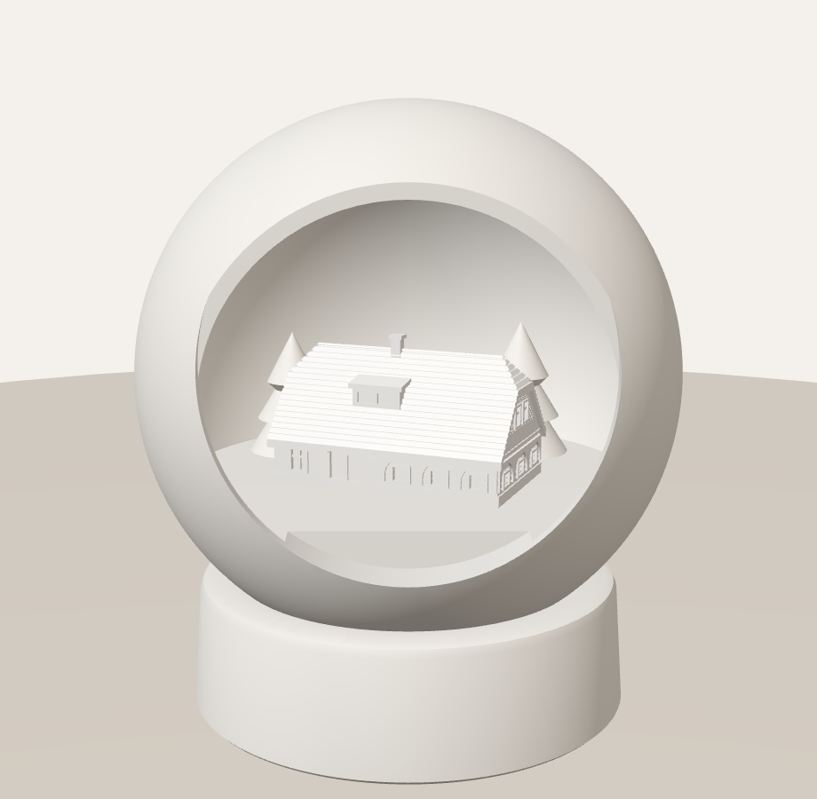
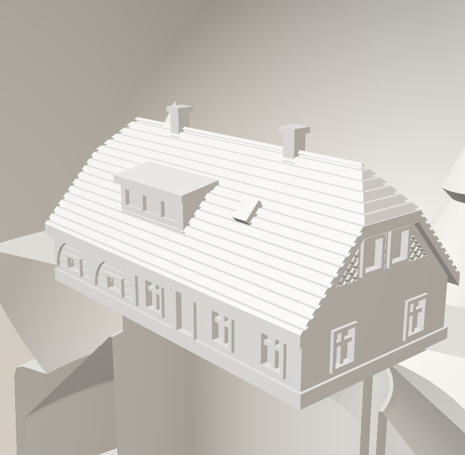
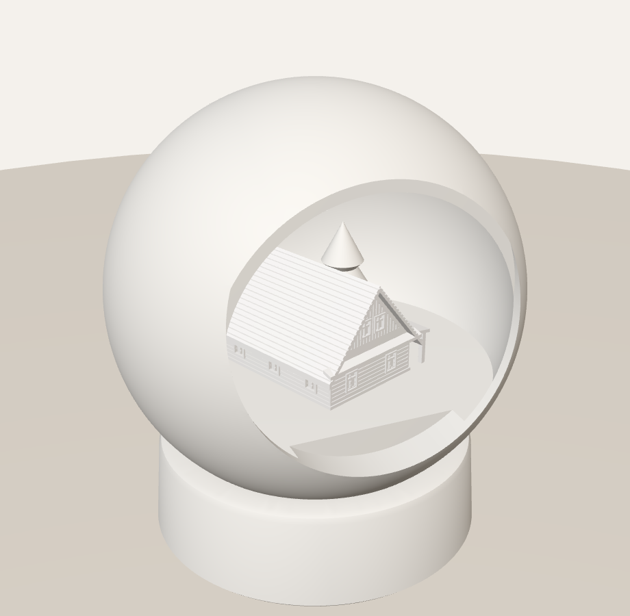

# Chalupa v kouli

Webový generátor vánoční dekorace: **koule se svíčkou, ve které stojí model konkrétního domu nebo chalupy**.
Dům se poskládá z parametrů podle fotky (rozměry v metrech, typ střechy, okna, oblouky podstávky, vikýře…),
program ho sám zmenší do koule, přidá stromky, otvor na svíčku a vyexportuje **3MF pro Bambu Studio**.

<p>



</p>

Běží celé v prohlížeči (bez serveru, bez nahrávání dat) – fotka i model zůstávají u tebe.

▶ **Spuštění:** `https://frenkeeone.github.io/chalupa-v-kouli/` (po zapnutí GitHub Pages: *Settings → Pages → Branch `main` / root*).

---

## Jak s tím pracovat

1. **Nahraj fotku** domu (tlačítko 📷) – zobrazí se vpravo nahoře jako předloha.
2. Vyber nejbližší **předlohu** (podstávkový dům, roubenka, chata s mansardou, přístřešek…).
3. Uprav **rozměry v metrech** (délka okapové strany, hloubka, výška stěn po okap). Stačí odhad –
   např. podle počtu oken (okno ≈ 1,1 m, rozestup ≈ 1,5–2 m) nebo výšky dveří (≈ 2 m).
4. Nastav střechu a **skladbu každé stěny** zleva doprava (při pohledu zvenku):
   `O` okno · `D` dveře · `B` podstávkový oblouk s oknem · `A` oblouk bez okna · `-` mezera,
   číslo opakuje – např. `2O D 3O` nebo `B B D O D B B`. Stačí klikat na tlačítka pod polem.
   Pak vikýře, komín, přístřešky. Náhled se přepočítá sám.
5. **Natočení domu** nastav tak, aby z okna koule byla vidět strana jako na fotce
   (0° = okapová strana do okna, −90° = pravý štít do okna, 90° = levý štít).
6. **Stáhnout 3MF** → otevřít v Bambu Studiu.

Tlačítkem **Uložit** si nastavení uložíš do `.json` (např. pro zákazníka), **Načíst** ho vrátí.

## Tisk

| | |
|---|---|
| Koule | Ø 90 mm (nastavitelné), celkem cca 74 × 74 × 101 mm (výška ≈ 1,12 × průměr), šikmý řez vpředu (odstup a sklon nastavitelné) |
| Otvor na svíčku | Ø 42 mm zespodu, nálevka vede světlo přímo do domku |
| Domek | dutý, stěny 1,2 mm, okna ztenčená na 0,6 mm → **svíčka je rozsvítí zevnitř** |
| Výška vrstvy | 0,2 mm |
| Podpěry | **strom (auto)** – potřebuje je jen klenba koule nad oknem (stejně jako originál) |
| Výplň | 10–15 % stačí; podstavec má uvnitř uzavřenou dutinu (lze vypnout) |
| Materiál | bílé PLA (prosvítá nejlépe) |

**Režim „domek zvlášť“** vytiskne dům jako samostatný díl (bez podpěr, čistší střecha) a v kouli
nechá 0,6 mm zahloubení pro jeho usazení. Domek se do koule vkládá oknem (případně šikmo), lepí se kapkou lepidla.

## Co generátor umí

- střechy: sedlová, polovalbová, valbová, mansardová, pultová; přesahy u okapu i štítu
- krytina: kosočtverce (eternit/břidlice), řady tašek, svislé drážky (plech/prkna), hladká
- stěny: hladké, roubení (vodorovné drážky), svislá prkna, roubení jen v úseku s **podstávkovými oblouky**
- obklad štítu: svislá / vodorovná prkna, šupiny (břidlice, šindel)
- skladba každé stěny (okna, dveře, podstávkové oblouky, mezery v libovolném pořadí), okna ve štítu
- ležaté vikýře, střešní okna, komíny
- 2 přístřešky / přístavky (otevřené se sloupky a zábradlím nebo uzavřené), stříška mezi patry (podlomenice)
- automatické měřítko: dům se zvětší na maximum, které se vejde do koule a je celý vidět oknem
- 1–2 stromky za domem (vykukují po stranách)

## Struktura

```
index.html          – aplikace
js/geometry.js      – geometrie (manifold-3d): koule, dům, stromky, měřítko
js/presets.js       – předlohy
js/app.js           – formulář, 3D náhled (three.js), export
js/worker.js        – výpočet mimo hlavní vlákno
js/export.js        – zápis 3MF / STL
vendor/             – three.js, manifold-3d (WASM), fflate – vše lokálně, bez CDN
tools/              – testy v Node (sestavení všech předloh, náhodný „fuzz“ test parametrů)
```

Test v Node (potřebuje `npm i manifold-3d`):

```
node tools/test-node.mjs ./node_modules/manifold-3d/manifold.js ./out
node tools/fuzz-node.mjs ./node_modules/manifold-3d/manifold.js 100
```

## Licence

Kód: MIT. Knihovny ve `vendor/` mají vlastní licence (three.js – MIT, manifold-3d – Apache 2.0, fflate – MIT).
Autor nesbírá žádná data – vše běží lokálně v prohlížeči.
